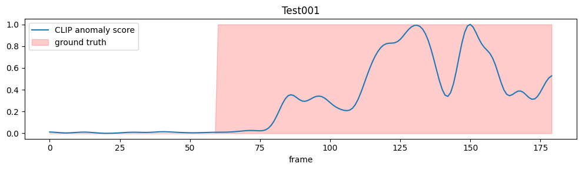
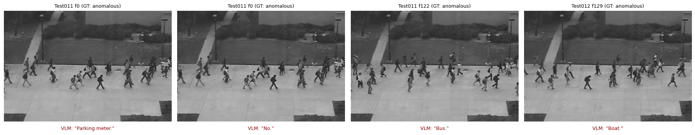

# Zero-Shot Video Anomaly Detection with CLIP + VLM Explanations (UCSD Ped2)

Training-free video anomaly detection on UCSD Ped2 using CLIP text prompts, followed by a study of whether
small vision-language models (SmolVLM, 256M / 500M / 2.2B) can **explain** what is unusual in the detected
frames. The study includes a normal-frame control experiment to check that the explanations reflect the image
and not just the prompt.

> Author: [Nimra Abdulhaq] · Notebook: `Anomaly_detection.ipynb` · Runs on a free Colab T4 GPU

## Key results

| What | Result |
|---|---|
| CLIP zero-shot frame-level AUC (Ped2 test, no training) | **0.882** |
| Effect of temporal smoothing (sigma 0 → 3) | 0.844 → 0.882 |
| Best VLM setup after normal-frame control | SmolVLM-2.2B, "direct" prompt: **85.7%** keyword hits on anomalous frames vs **5.6%** on normal frames |
| Setup that looked best but was not | SmolVLM-2.2B, "open" prompt: 97.1% on anomalous frames, but also 89-100% on normal frames |

The main finding: **VLM explanation quality depends heavily on the prompt**, and a high hit rate on anomalous
frames alone can be misleading. Without the control experiment, the "best" configuration would have been the
one that names a vehicle on almost every frame.

## Dataset

[UCSD Anomaly Detection Dataset](http://www.svcl.ucsd.edu/projects/anomaly/dataset.htm), Ped2 test split:
12 videos, 2010 frames, with pixel-level ground truth. A frame is labelled anomalous if any ground-truth pixel
is non-zero (cyclists, skateboarders, vehicles, wheelchairs on a pedestrian walkway).

**Class balance:** about **82% of test frames are anomalous** (362 normal frames out of 2010). Accuracy-style
numbers on this split are therefore easy to inflate. AUC is used as the main metric.

## Method

### 1. CLIP zero-shot anomaly score
- Model: `openai/clip-vit-base-patch32`. Ped2 frames are grayscale and are converted to RGB.
- Text prompts, 3 normal (e.g. "people walking on a walkway") and 5 anomalous (e.g. "a person riding a bicycle").
- For each frame: softmax (temperature 100) over cosine similarities with all prompts. The anomaly score is the
  total probability mass on the anomalous prompts.
- Gaussian temporal smoothing (sigma = 3), then per-video min-max normalization.
- Frame-level AUC is computed on the pooled frames of all test videos.

### 2. VLM explanation of detected frames
- The 3 highest-scoring frames per video (minimum spacing of 15 frames) give 36 frames. 35 of them are
  truly anomalous.
- Three models (`SmolVLM-256M`, `SmolVLM-500M`, `SmolVLM-Instruct` 2.2B) and three prompts:
  - `open`: "Besides people walking, what vehicle or object is present?"
  - `direct`: "Is there a bicycle, skateboard, car, cart or wheelchair among the pedestrians? Say which one."
  - `unusual`: "What is unusual or abnormal in this frame?"
- Frames are upscaled 4x because Ped2 frames are very small.
- Metric: **keyword-match accuracy**, the share of frames whose answer contains an anomaly keyword
  (bicycle, skateboard, car, cart, wheelchair, ...). This is a word match only. It does not verify that the
  right object was described.

### 3. Normal-frame control
The selected frames are almost all anomalous, so a model that always says "bicycle" would score highly. To test
this, the same prompts were run on 36 truly normal frames: 18 with the lowest CLIP score and 18 chosen at
random (seed 0). `gap` is the hit rate on anomalous frames minus the hit rate on random normal frames.

## Results

### CLIP anomaly detection (`clip_ablation.csv`)

| Setting | AUC |
|---|---|
| main prompts, sigma = 0 | 0.8438 |
| main prompts, sigma = 2 | 0.8693 |
| **main prompts, sigma = 3** | **0.8816** |
| main prompts, sigma = 5 | 0.8859 |
| main prompts, sigma = 8 | 0.8883 |
| only bicycle + skateboard prompts, sigma = 3 | 0.8783 |
| single normal prompt, sigma = 3 | 0.8813 |

- Smoothing helps clearly. Larger sigma gives small further gains. Sigma was not tuned on held-out data,
  so differences between sigma 3 and 8 should not be over-interpreted.
- The choice and number of prompts changes AUC very little (0.878 to 0.882).
- The 36 top-scored frames are 97.2% truly anomalous, compared with an 82.0% base rate, a modest gain.

### VLM explanations with normal-frame control (`vlm_control_table.csv`)

Hit rates (keyword match). Sample sizes: 35 anomalous frames, 18 normal-lowest, 18 normal-random.

| Model | Prompt | Anomalous | Normal (lowest score) | Normal (random) | Gap |
|---|---|---|---|---|---|
| SmolVLM-256M | open | 0.943 | 0.278 | 0.278 | 0.665 |
| SmolVLM-256M | direct | 0.943 | 0.778 | 0.556 | 0.387 |
| SmolVLM-256M | unusual | 0.200 | 0.000 | 0.000 | 0.200 |
| SmolVLM-500M | open | 0.914 | 0.222 | 0.167 | 0.747 |
| SmolVLM-500M | direct | 0.943 | 0.278 | 0.389 | 0.554 |
| SmolVLM-2.2B | open | 0.971 | 0.889 | 1.000 | -0.029 |
| SmolVLM-2.2B | direct | 0.857 | 0.056 | 0.056 | **0.801** |

**Findings**

1. **The neutral prompt fails.** Asking "what is unusual?" gives only 20% hits (7/35). The small model answers
   with generic phrases such as "people are crossing the walkway". An earlier exploratory run with 3x upscaling
   and a different token limit gave 14%, which shows how sensitive the result is to small setup changes.
2. **Vehicle-oriented prompts can inflate results.** SmolVLM-2.2B with the `open` prompt scores 97% on anomalous
   frames, but also 89-100% on normal frames (gap about 0). It names a vehicle almost everywhere, so its
   headline number reflects prompt bias, not detection.
3. **Best discrimination:** SmolVLM-2.2B + `direct` (0.857 vs 0.056) and SmolVLM-500M + `open`
   (0.914 vs 0.167).
4. **Model size is not monotonic.** The 256M model with the `direct` prompt fires on 56-78% of normal frames,
   while the 2.2B model with the same prompt almost never does.
5. **Hallucinations occur.** The failure cases above show answers such as "Parking meter.", "Bus." and "Boat." on a plain pedestrian walkway, and "No." for a frame with an anomaly. Other runs produced "Parade." and "People are running." Each failure image shows the frame with the model's answer below it.

## Limitations

- **Hand-written prompts use dataset knowledge.** The anomaly prompts (bicycle, skateboard, car, wheelchair)
  were written knowing Ped2's anomaly types, so this is not open-world or "non-specific" anomaly detection.
- **Keyword matching is a weak proxy.** It does not check that the described object is correct, and it ignores
  negation ("there is no bicycle" would count as a hit).
- **Small, biased samples.** 36 anomalous-heavy frames chosen by CLIP's highest scores (the easy cases) and
  18 + 18 control frames. One control frame is about 5.6 percentage points. No confidence intervals are reported.
- **Single dataset.** Only Ped2. No results on Avenue, ShanghaiTech or UCF-Crime.
- **Pooled AUC with per-video normalization.** Per-video AUCs are not reported, and some videos contain
  very few normal frames.
- The Ped2 training split (normal videos only) is not used.

## Future work

- Prompt-free scoring: build a normal memory bank from the Ped2 training frames and score test frames by
  nearest-neighbour distance, so anomaly types do not need to be named. Compare with the text-prompt scores.
- Manual review of explanations instead of keyword matching.
- Test on additional datasets and report per-video AUC.

## Reproduce

1. Open `Anomaly_detection.ipynb` in Google Colab with a T4 GPU runtime.
2. Run all cells in order. The dataset (about 500 MB) is downloaded by the notebook and is not included here.
3. Outputs are written to the Colab working directory.

## Files

| File | Content |
|---|---|
| `Anomaly_detection.ipynb` | Full pipeline with saved outputs |
| `clip_ablation.csv` | Smoothing and prompt ablation (AUC) |
| `vlm_ablation.csv` | VLM keyword-match accuracy on anomalous frames |
| `vlm_control_table.csv` | VLM hit rates on anomalous vs normal frames |
| `results/score_graph.png` | CLIP anomaly score vs ground truth for one video |
| `results/failure_cases.png` | VLM answers on anomalous frames with no anomaly keyword |

## Acknowledgements

UCSD Anomaly Detection Dataset (Mahadevan et al.), OpenAI CLIP, Hugging Face SmolVLM, Hugging Face
`transformers`.
